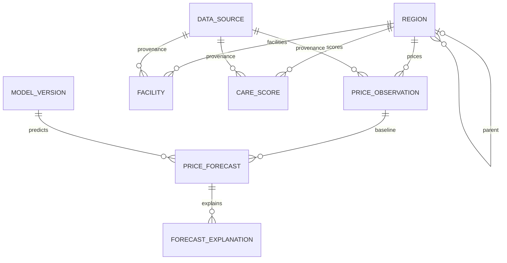

# SpotFit ERD — 제안 초안

현재 `backend/app/models`에는 서비스 ORM 모델이 없으며 SQL은 PostGIS 확장만 생성합니다.
이 문서는 지도·주거 가격 예측·양육환경 기능을 위한 **미구현 논리 설계**입니다.
기존 모델 manifest JSON은 존재하지만 MODEL_VERSION DB 테이블이 존재하는 것은 아닙니다.

## 저장 단위·정합성

- REGION: 코드와 유효 시작일로 구분하는 지역 버전. 동일 코드의 유효기간 중복을 금지하고 부모 순환을 방지합니다. 경계는 MultiPolygon(4326)으로 통일합니다.
- PRICE_OBSERVATION: 지역 버전 × 기간 × 주택 유형 × 거래 유형 × 집계 방법 × 원자료 버전별 가격. 해당 조합의 중복을 금지합니다. 매매부터 구현하고 전월세는 보증금/월세의 정의를 별도로 정한 후 확장합니다.
- PRICE_FORECAST: 관측 기준가격 × 모델 버전 × 예측 기준일 × 예측기간 조합을 유일하게 관리합니다. 12·36개월만 허용하고 목표일과 기간의 일치를 검증합니다. 예측값의 단위는 관측값과 같은 만원/㎡입니다. 예측 구간은 검증된 산출 방법이 있을 때만 저장합니다.
- FACILITY: 원자료 버전 × 원천 시설 ID × 관측일 스냅샷. 현재 시설을 과거 학습 시점에 소급 적용하지 않습니다.
- CARE_SCORE: 지역 × 기준일 × 점수 산식 버전을 유일하게 관리합니다. JSONB는 점수 구성 내역이며 확정된 분석 피처를 대체하는 저장소가 아닙니다.
- MODEL_VERSION: 기존 Git manifest를 참조하는 DB 색인 제안입니다. 모델 파일 자체는 MinIO에 유지하며 모델 버전별 평가 지표, 학습 종료일, 피처 스키마를 기록합니다.
- DATA_SOURCE: 자료의 배포 버전/수집 스냅샷 단위입니다. 여러 원천을 결합한 결과에는 파생 데이터 버전을 만들고, 상세 추적이 필요하면 별도 출처 연결 테이블을 추가합니다.
- FORECAST_EXPLANATION: 예측별 변수 기여도. SHAP 등 실제 사용한 방법과 단위를 명시해야 하며 인과관계로 표현하지 않습니다.

## 아직 확정하지 않은 부분

원천 실거래 테이블, 양육환경 지표, 피처 테이블, 주소/건물 식별자, 결측 처리, 시·구 가격 집계 방식은 데이터 분석 이후 정합니다.
시·구 대표가격은 동별 평균을 단순 평균하지 않고 거래 표본과 동일 집계 기준을 사용해야 합니다.
행정구역 개편 전후 비교는 별도 대응 정책이 필요합니다.
이 설계는 DB 생성이나 마이그레이션을 실행하지 않습니다.
