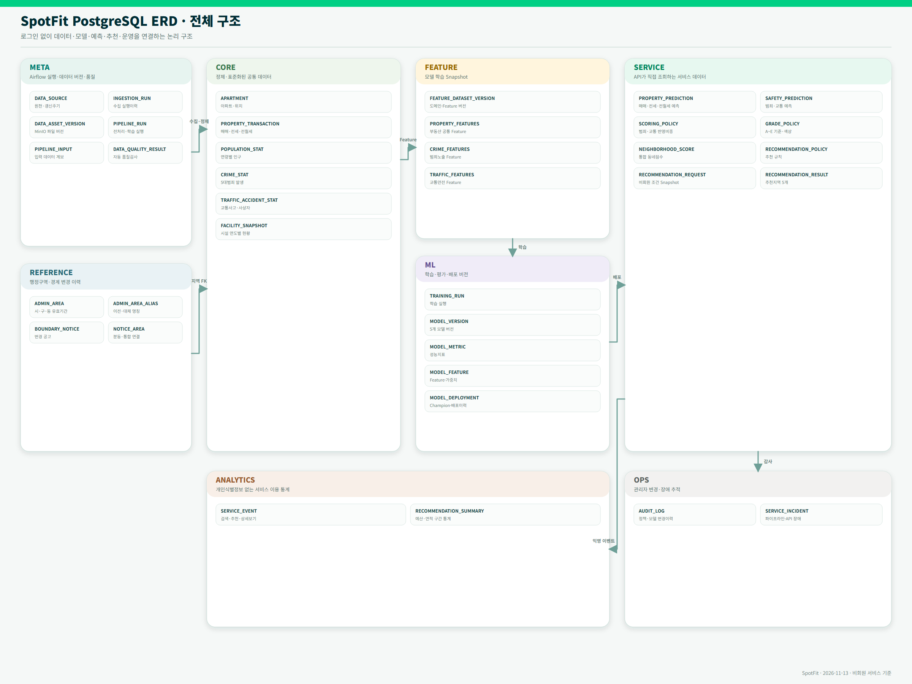
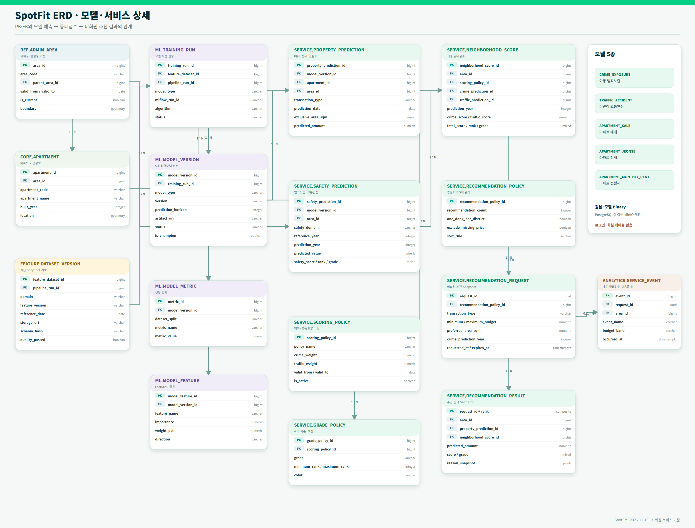
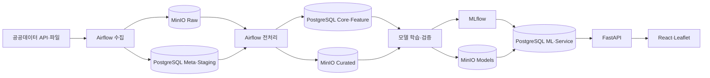
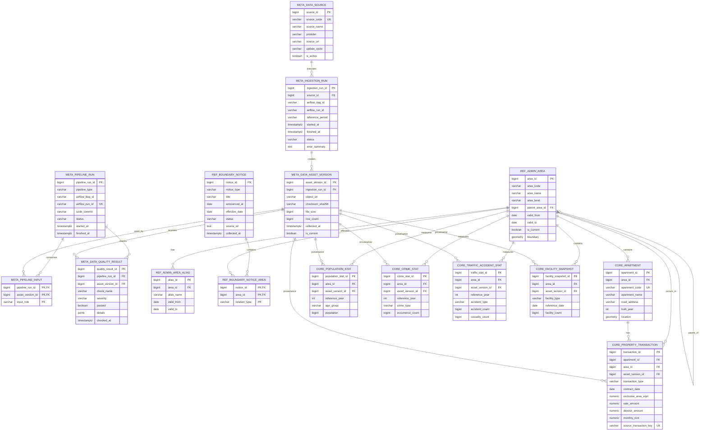
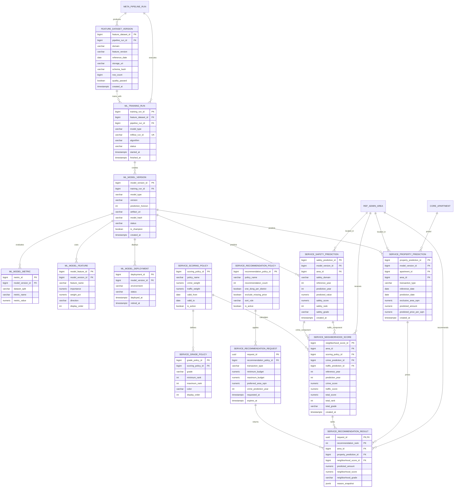
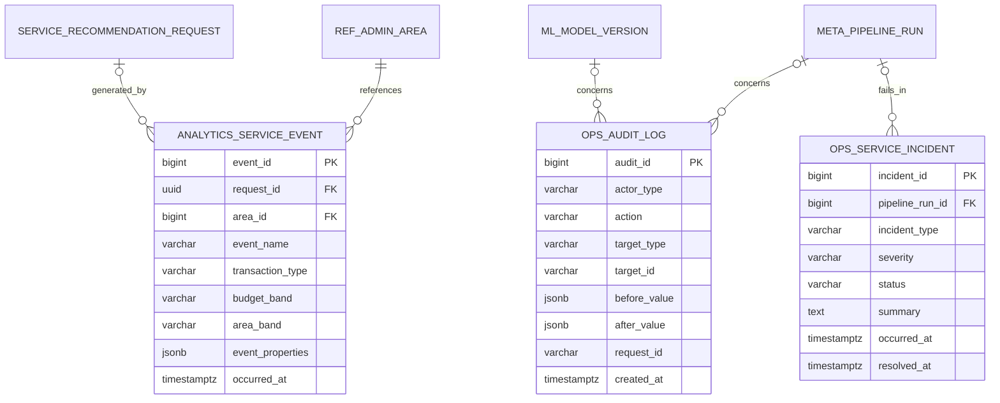

# SpotFit PostgreSQL ERD v2

기준일: 2026-11-13  
범위: 비회원 서비스, 데이터 수집·전처리, 5개 최종모델, 예측·추천·운영정보

이 문서는 논리 ERD이며 아직 PostgreSQL Migration을 실행한 것은 아니다. 회원가입을 제공하지 않으므로 사용자, 비밀번호, 개인 프로필, 개인 즐겨찾기 테이블은 포함하지 않는다.

### 실행 가능한 SQL (2026-11-16 추가)

[DB 생성·초기데이터 실행 안내](../../infra/postgres/migrations/README.md)와 [설치 SQL](../../infra/postgres/migrations/000_install.sql)을 제공합니다. ERD 업무 테이블 33개와 보조 테이블 2개, 서울 25개 구·427개 행정동 및 기준 정책을 생성합니다. 임시 PostGIS에서 검증했으며, **운영 DB 적용과 백엔드의 DB 조회 전환은 별도**입니다. 물리 설계에서 추가한 필드·제약조건은 실행 안내에 정리했습니다.

## 시각화 파일

- [전체 구조 PNG](erd_visuals/spotfit_erd_full.png)
- [전체 구조 SVG](erd_visuals/spotfit_erd_full.svg)
- [모델·서비스 상세 PNG](erd_visuals/spotfit_erd_service_detail.png)
- [모델·서비스 상세 SVG](erd_visuals/spotfit_erd_service_detail.svg)
- [브라우저 확대·스크롤 보기](erd_visuals/spotfit_erd_visualization.html)

## 저장소 역할

| 저장소 | 저장 대상 |
|---|---|
| PostgreSQL·PostGIS | 표준 데이터, 행정구역, 모델 메타데이터, 예측값, 점수, 추천 결과, 정책, 익명 통계 |
| MinIO `spotfit-raw` | 수집한 원본 CSV·XLS·XLSX·JSON |
| MinIO `spotfit-curated` | 대용량 전처리 결과와 학습용 Parquet |
| MinIO `spotfit-models` | Joblib 등 서비스 모델 파일 |
| MLflow | 실험 파라미터, 성능지표, Run·Registry 버전, 모델 Artifact 연결 |
| 파일 로그 | API 전체 로그와 예외 Stack Trace |

## 전체 데이터 흐름

## 1. 데이터 수집·행정구역·표준 데이터 ERD

### 행정구역 설계 원칙

- `REF_ADMIN_AREA`는 현재 행정동만 덮어쓰지 않고 `valid_from`, `valid_to`로 과거 버전을 보존한다.
- 분동·통합처럼 한 공고에 여러 구역이 연결될 수 있으므로 공고와 지역은 `REF_BOUNDARY_NOTICE_AREA`로 다대다 연결한다.
- `relation_type`은 `OLD`, `NEW`, `AFFECTED` 중 하나를 사용한다.
- 경계는 PostGIS `MultiPolygon`, 좌표계는 서비스 표준 SRID 하나로 통일한다.

## 2. Feature·모델·예측·추천 ERD

### 모델 유형 코드

| `model_type` | 모델 |
|---|---|
| `CRIME_EXPOSURE` | 아동 지역범죄 노출 모델 |
| `TRAFFIC_ACCIDENT` | 어린이 교통사고·교통안전 모델 |
| `APARTMENT_SALE` | 아파트 매매가격 모델 |
| `APARTMENT_JEONSE` | 아파트 전세가격 모델 |
| `APARTMENT_MONTHLY_RENT` | 아파트 전월세가격 모델 |

### 비회원 추천 요청 보존 원칙

- 추천 요청에는 이름, 이메일, 전화번호, 비밀번호, 정확한 IP를 저장하지 않는다.
- 예산은 필요하면 정확한 값 대신 구간으로 저장할 수 있다.
- `expires_at` 이후 요청·결과를 자동 삭제하는 보존정책을 적용한다.
- 이전 추천 결과 재현이나 통계가 필요 없으면 `SERVICE_RECOMMENDATION_REQUEST`, `RESULT`는 저장하지 않고 요청 즉시 계산해 반환해도 된다.

## 3. 익명 분석·운영 ERD

### 익명 이벤트 예시

- `SEARCH_AREA`
- `SUBMIT_RECOMMENDATION`
- `OPEN_REGION_DETAIL`
- `CHANGE_BUDGET_BAND`
- `CHANGE_AREA_PRESET`
- `CLICK_RECOMMENDED_AREA`

익명 이벤트에는 개인을 식별할 수 있는 값 대신 거래유형, 예산구간, 면적구간, 지역코드와 발생시각만 저장한다.

## 핵심 제약조건

1. 활성 Champion은 동일 `model_type`·예측기간당 하나만 허용한다.
2. 모델 배포 전 필수 성능지표와 데이터 품질검사가 모두 통과해야 한다.
3. `SERVICE_NEIGHBORHOOD_SCORE`에는 계산 당시 정책과 모델 버전을 추적할 수 있어야 한다.
4. 범죄·교통 점수 가중치 합은 1 또는 100%가 되어야 한다.
5. 추천 결과는 요청 당시 가격·점수 Snapshot을 보존해 이후 모델 갱신에도 재현 가능해야 한다.
6. 동일 원본 체크섬은 중복 수집하지 않는다.
7. 원본 데이터와 모델 Binary는 PostgreSQL에 저장하지 않는다.
8. 행정구역 유효기간이 겹치거나 부모 지역이 순환하지 않도록 검증한다.

`staging` 테이블은 외부 원천마다 컬럼 구성이 달라 이 논리 ERD에서는 생략한다. 실제 구현 시 각 원천 Schema를 거의 그대로 보존하는 별도 테이블로 생성한다.

## 1차 구현 대상

현재 서비스에 먼저 필요한 테이블은 다음과 같다.

1. `REF_ADMIN_AREA`
2. `REF_BOUNDARY_NOTICE`, `REF_BOUNDARY_NOTICE_AREA`
3. `META_DATA_SOURCE`, `META_INGESTION_RUN`, `META_DATA_ASSET_VERSION`
4. `META_PIPELINE_RUN`, `META_DATA_QUALITY_RESULT`
5. `CORE_APARTMENT`, `CORE_PROPERTY_TRANSACTION`
6. `FEATURE_DATASET_VERSION`
7. `ML_TRAINING_RUN`, `ML_MODEL_VERSION`, `ML_MODEL_METRIC`, `ML_MODEL_FEATURE`
8. `SERVICE_PROPERTY_PREDICTION`, `SERVICE_SAFETY_PREDICTION`
9. `SERVICE_SCORING_POLICY`, `SERVICE_GRADE_POLICY`, `SERVICE_NEIGHBORHOOD_SCORE`
10. `SERVICE_RECOMMENDATION_POLICY`

추천 요청 이력과 익명 이용통계는 서비스 분석이 필요해지는 시점에 2차로 추가해도 된다.
